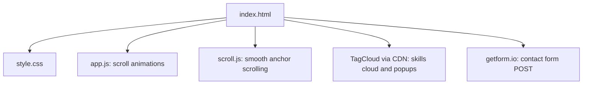

# Website

My personal website, built from scratch with HTML, CSS and JavaScript. It has an about-me section, a skills section, a projects section and a contact form.


## Sections

- **Landing**: an animated "Hi, I'm Alex" welcome with a portrait, over a CSS starfield, and a navigation bar (About, Skills, Projects, Contact).
- **About**: three paragraphs of text that fade and slide in as you scroll.
- **Skills**: an interactive 3D word cloud (TagCloud 2.2.0, loaded from the jsDelivr CDN) of ten skills: Java, Python, C, C++, HTML, CSS, SQL, JavaScript, x86 Assembly and Davinci Resolve. Clicking a word opens a popup with a short write-up of that skill.
- **Projects**: four cards linking to the GitHub repositories for Image Processor, UNIX Shell, FUSE File System and this website, each with a screenshot.
- **Contact**: a name/email/message form that posts to a getform.io endpoint, plus links to LinkedIn, GitHub, YouTube and Instagram.

## Files

| File | Purpose |
|---|---|
| `index.html` | Page structure, the skills word cloud and its popup text |
| `style.css` | All styling, including the starfield and animations |
| `app.js` | `IntersectionObserver` scroll animations for the About section, and `popUP()`, which closes the skill popup |
| `scroll.js` | Smooth scrolling for the in-page `#about`, `#skills`, `#projects` and `#contact` links |
| `*.png`, `*.jpg`, `*.jpeg` | Portrait and project screenshots |

Fonts come from Google Fonts (Montserrat) and icons from a Font Awesome kit script, so the page needs network access to render fully.

## Running locally

There is no build step or dependency install. Open `index.html` in a browser, or serve the folder with any static file server, for example:

```
python -m http.server
```

Then visit `http://localhost:8000`.


## Known issues

- Not responsive. `index.html` sets a viewport meta tag, but the only media query in `style.css` is `prefers-reduced-motion`. Commit `6844eb5` (2023-02-07) says viewing on mobile or smaller screens still needed fixing.
- The last line of `app.js` (`document.querySelectorAll('.tagCloudContainer').style.color = color;`) throws a `TypeError`, because a `NodeList` has no `style`. It runs after the observers are set up, so the page still works, but the console shows an error. `app.js` also logs every observer entry to the console.
- Markup is loose: for example an `<h2>` closed with `</h3>`, and a second `<html>` tag at the top of `index.html`.

## Page structure



_As of 2026-11-09._
